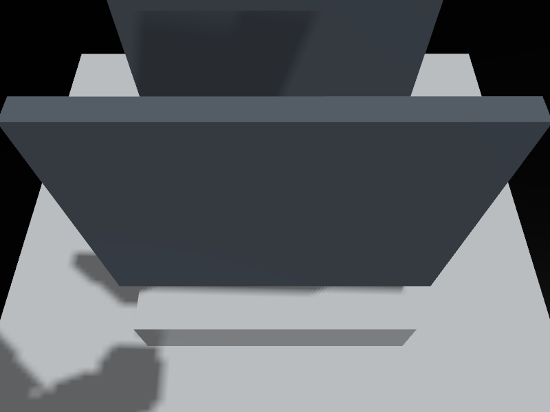
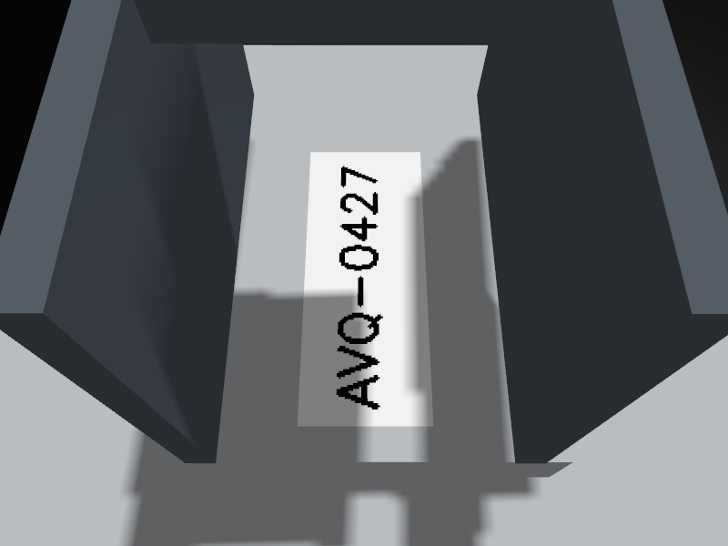

# ActiveVisionQA

ActiveVisionQA is a simulated robot inspection workcell. A UR5e carries a
camera, reads a part identifier, and moves to another viewpoint when the image
is blocked or inconclusive. Each run records the observations, motion checks
and inspection decision.

Built with Python, ROS 2 Jazzy, Gazebo Harmonic, MoveIt 2 and OpenCV. The camera
is attached to the robot tool. The current controller selects among five
configured viewpoints using known scene geometry and motion-planning costs.

| First observation | After selecting a side view |
|---|---|
|  |  |

## Run it

Use Ubuntu 24.04 with ROS 2 Jazzy. Development and the recorded runs used WSL 2
with WSLg. Gazebo camera rendering is required even when the GUI is disabled.
Use system Python outside a virtual environment.

Install ROS 2 Jazzy and its package repository using the
[official installation guide](https://docs.ros.org/en/jazzy/Installation/Ubuntu-Install-Debs.html),
then run these commands from the project root:

```bash
bash scripts/install_system_dependencies.sh
bash scripts/build.sh
bash scripts/test.sh
```

The installer uses sudo for the UR simulator, MoveIt configuration, camera
bridge, OpenCV and build tools. It does not install graphics drivers.

Generate the small synthetic OCR dataset and train the CPU recognizer locally:

```bash
bash scripts/ocr.sh generate --seed 733 --counts 80 20 20 --output outputs/ocr-data
bash scripts/ocr.sh train --dataset outputs/ocr-data --output outputs/ocr-model
```

Start an adaptive inspection with the front, back and overhead views obstructed:

```bash
bash scripts/active_vision.sh --ocr-model outputs/ocr-model \
  --scenarios top_occluded --policies next_best_view --gui
```

The arm first captures a blocked image, evaluates alternative goals, moves to a
feasible side view and checks the identifier again. It stays still during
planning previews. This is a bounded inspection episode; the workcell closes
when it finishes.

Open `comparison.html` in the printed output directory, then follow the run's
Evidence link for camera images, candidate scores and motion checks. Output
names must be new; existing recordings and models are never overwritten.

For all three policies across three obstruction scenes, omit the scene/policy
filters and `--gui`:

```bash
bash scripts/active_vision.sh --ocr-model outputs/ocr-model
```

## How it works

```text
RGB image + CameraInfo + timestamped TF
    -> identifier and image-quality checks
    -> accept / reject / select another view / escalate
    -> MoveIt plan -> trajectory checks -> execute -> measured camera pose
    -> fresh image and recorded outcome
```

After an inconclusive image, the selector estimates label visibility through
known boxes and previews useful camera goals with MoveIt. Its utility combines
projected label size, visibility, viewpoint change and motion cost. It chooses
a goal and replans from the current state before execution. The default budget
is two observations; no useful feasible goal means escalation.

Inspection uses ArUco markers or an OpenCV HOG/RBF-SVM recognizer for synthetic
text such as `AVQ-0427`. The OCR module supplies evidence to the controller.
There is no learned viewpoint policy or PyTorch/VLM dependency.

## Recorded checks

The 13 November 2026 comparison started each policy in a fresh workcell with
matching initial joint states:

| Scene | Fixed front view | Front/back sequence | Adaptive selection |
|---|---|---|---|
| Front/back blocked | Escalate, 1 view | Escalate, 2 views | Accept, 2 views; overhead |
| Overhead also blocked | Escalate, 1 view | Escalate, 2 views | Accept, 2 views; side |
| Label fully covered | Escalate, 1 view | Escalate, 2 views | Escalate, 1 view |

All nine expected outcomes passed their motion, image and decision audits.
The same implementation passed 125 unit/interface tests, five text-sequence
regression cases and a separate adaptive GUI case. These constructed scenes
obstruct the original front/back order; a different fixed order could do
better. Timings and rejected planning candidates are retained in the
[results](docs/ACTIVE_VISION.md#recorded-results--13-november-2026).

To run the original marker regression or image-only diagnostics:

```bash
bash scripts/validate_simulation.sh --include-unreachable
bash scripts/run_offline_demo.sh
```

The offline fixtures do not move a robot. Simulator checks run separately.

## Code and documentation

| Path | Purpose |
|---|---|
| `activevisionqa/` | Inspection, view selection, ROS adapter, data and evaluation |
| `config/` | Marker, text and adaptive inspection configurations |
| `launch/`, `urdf/` | Workcell launch and camera mounting |
| `scripts/` | Setup, build, demo, collection and evaluation commands |
| `tests/` | Geometry, interface, perception, policy and evidence checks |
| `docs/` | Technical guides and small recorded evidence samples |

- [View selection and its limits](docs/ACTIVE_VISION.md)
- [OCR training and evaluation](docs/OCR.md)
- [Robot-camera dataset collection](docs/TEXT_DATASET.md)
- [Original marker demonstration](docs/DEMO.md)
- [Validation history](docs/VALIDATION.md)
- [Dependencies and asset terms](docs/DEPENDENCIES.md)

Development uses the `dev` branch. Feature branches should target `dev`.
Generated data, trained models, build/install trees, logs and local notes are
excluded from version control. Recreate runtime artifacts using the scripts.

## Current limits

The workcell is static and its box geometry and label location are known.
Visibility selection uses a finite candidate pool and a heuristic score.
The markings use one synthetic font family; real engraving, factory glare,
unknown obstacles and physical-robot operation have not been validated.

Motion is collision-aware with sampled checks and measured pose verification;
these checks are not a hardware safety certificate. WSL rendering acceleration
is unverified, and MoveIt/OMPL trajectories and timings can vary between runs.
Next evaluation work is randomized held-out geometry and stronger fixed-view
sequences before training a view-selection model.

Third-party robot assets come from installed packages and have their own
terms. A distribution license for this project's code has not been selected.
