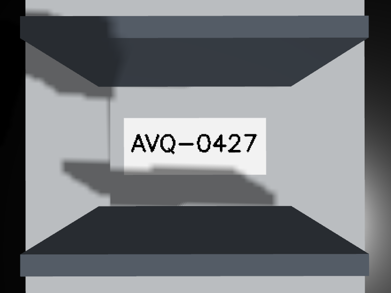
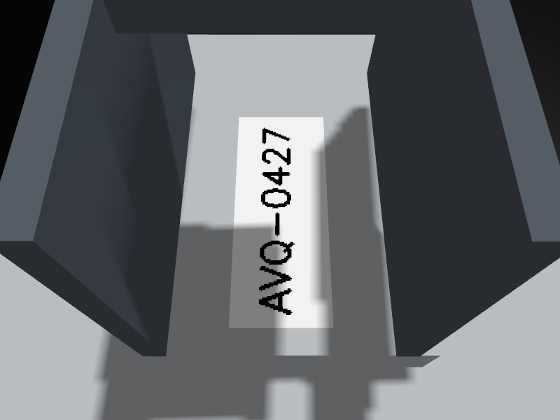

# Active viewpoint selection: the Physical AI controller

The core task is now an evidence/action loop: inspect, decide whether more evidence is needed, choose a useful reachable camera goal, plan/execute it, and inspect the new observation. OCR supplies one inspection measurement. The new controller chooses among five configured camera poses instead of always advancing through a fixed list.

This implementation is a **model-based next-best-view baseline** using known workcell geometry and actual MoveIt motion previews. Its utility is not learned, and neither PyTorch nor a vision-language model is used. The existing trained OpenCV OCR can later be replaced independently of the action-selection interface.

## Run the core demonstration

```bash
bash scripts/active_vision.sh --ocr-model outputs/ocr-model-final-01 \
  --scenarios top_occluded --policies next_best_view --gui
```

It starts an owned Gazebo workcell, inspects the blocked front view, evaluates alternatives, moves to a selected feasible side view, verifies the resulting image and saves a report. It stops its workcell afterward. Default ROS domain is 75 with a private Gazebo partition; set `AVQA_ACTIVE_ROS_DOMAIN_ID` to change it. The separate interactive demo uses domain 67.

During planning previews the arm stays still. Open the printed directory's `comparison.html`, then the run's evidence link. The run report shows the camera images, recognized text and candidate visibility/cost/utility table.

For the full comparison:

```bash
bash scripts/active_vision.sh --ocr-model outputs/ocr-model-final-01
```

Default: three scenes × fixed-view, fixed-sequence and next-best-view policies, nine fresh workcells. Every policy starts from a fresh initial robot state. Existing outputs are never overwritten.

## Inputs and action selection

The first observation uses a common configured view for all policies. After inconclusive evidence, the new controller:

1. Queries the actual MoveIt planning scene for world box geometry and reads current camera pose/calibration.
2. Projects the known label footprint into each untried camera pose and traces 25 rays through the known boxes to estimate visible fraction. Out-of-workspace, out-of-frame, back-facing and insufficiently visible goals are rejected.
3. Requests bounded **plan-only** MoveIt previews for useful candidates. IK, joint bounds and sampled collision checks must pass. A geometrically useful but unreachable candidate is discarded.
4. Ranks feasible goals using visibility, projected label size, incidence, viewpoint change, planned execution time and joint-space path length.
5. Selects the highest utility, then **replans from the current state before execution**. Preview trajectories are advisory and are never executed from a stale cache.
6. Checks execution success and measured camera pose, acquires a newer timestamped image and either makes a definitive decision or continues/escalates within its budget.

The selector's `SelectionParameters` deliberately omits expected IDs, surface strings and scene names. Box names are trace labels, not decision rules. The world is known from its registered collision geometry; obstacle locations are not inferred from RGB in this baseline.

For default weights, utility is:

```text
4 × estimated visible fraction
+ 1 × min(projected shortest label edge / 150 px, 1)
+ 0.25 × incidence cosine
+ 0.2 × viewpoint angular change / pi
- 0.08 × planned execution seconds
- 0.03 × planned joint-space path length in radians
```

Insufficient-resolution evidence increases the resolution weight; some quality/recognition failures increase the viewpoint-change weight. These are explicit engineering rules, not calibrated probabilities, risk estimates or information gain.

`config/active_inspection.json` defines the five candidate camera positions: front (`view_1`), back (`view_2`), left (`view_3`), right (`view_4`) and overhead (`view_5`). Default budget is two motion attempts/observations, at most four candidate previews per decision and a 60-second episode guard. In-flight service/action operations have separate timeouts, so this is not a hard real-time deadline.

The controller stops on execution uncertainty. If camera acquisition becomes unavailable or untrustworthy, it escalates instead of treating another movement as a sensor repair. Unsupported non-box world geometry or a missing scene model is reported explicitly rather than treated as free space. Movement still uses the full MoveIt collision model; visibility estimation currently models world boxes only.

## Recorded results — 13 November 2026

`outputs/active-vision-comparison-01/` completed with **9/9 expected outcomes and matching initial joint states**. Each policy received the same five-candidate pool; fixed-sequence spends its two-view budget on the predeclared front/back order.

| Scene | Fixed view | Fixed sequence, budget 2 | Next-best-view, budget 2 |
|---|---|---|---|
| Front/back views blocked | ESCALATE, 1 view | ESCALATE, 2 views | ACCEPT, 2 views; selected overhead |
| Front/back plus overhead blocked | ESCALATE, 1 view | ESCALATE, 2 views | ACCEPT, 2 views; selected side |
| Label covered from every candidate | ESCALATE, 1 view | ESCALATE, 2 views | ESCALATE, 1 view; no further useful candidate |

Measured inspection times, excluding startup/readiness:

| Scene | Fixed sequence | Next-best-view |
|---|---:|---:|
| Front/back blocked | 11.547 s | 9.903 s |
| Overhead also blocked | 11.510 s | 12.791 s |
| Fully covered | 11.116 s | 4.782 s |

Preview planning adds overhead: the adaptive run is slower in the overhead-obstructed example, while obtaining a definitive result. These single, deliberately constructed scenarios do not establish a general success-rate or cycle-time improvement. A different fixed sequence could perform better than the original front/back order; broader randomized/held-out comparisons remain necessary.

In both successful adaptive cases, a configured right-side candidate failed collision-aware IK and was discarded. In the overhead-obstructed case the overhead view was filtered geometrically, leaving the feasible side view. No motion was executed during the preview queries. Final goals were freshly planned and actual optical poses/images checked. Decision audits also verified that the executed choice matched the highest feasible recorded score and that no candidate was revisited.

All five original fixed-sequence text regression cases passed in `outputs/sequence-regression-after-active-01/`. The unit/interface suite passes **125 tests**, including ray/box geometry, frame composition, geometry-dependent selection, motion cost, preview/time budgets, sensor/execution failures and rejection of stale preview execution. Colcon build, Python compilation and shell syntax checks passed.

A separate GUI run of the overhead-obstructed scene also passed: side selected, ACCEPT after two verified motions/images in 12.370 s. The GUI initialized and the server supplied rendered images; this is not a human review of its appearance or a GPU-acceleration benchmark. Its owned workcell was stopped afterward.

Actual arm-camera evidence after selecting overhead:



Actual arm-camera evidence after blocking overhead and selecting the side instead:



The corresponding blocked first observations and rectified recognition crops are also retained in `docs/active_vision/`; these are unmodified copies of the simulator outputs.

Portable summaries and camera examples are in [active_vision/results.json](active_vision/results.json). The local `outputs/active-vision-comparison-01/comparison.html` retains per-run evidence and candidate score tables. Runtime outputs are excluded from Git; rerun the comparison to generate a report on another machine.

## Future learned components

The SVM supplies a reproducible inspection reference. Alternative OCR models could be evaluated independently of view selection. Any future model that proposes an action must still pass the motion-feasibility checks.

A useful next learned component could predict candidate-view utility from image/state/action data. PyTorch would be appropriate for fitting that neural model after defining data, losses and comparisons. Logs now retain candidate features, preview costs, selected actions and subsequent inspector feedback. **Unselected candidate outcomes remain unknown**; they must not be fabricated as negative training labels. Counterfactual data collection or controlled exploration will be needed to compare learned policies fairly.

Remaining limits: static known box world, finite candidate pool, heuristic utilities, uncalibrated inspection gates, single-font OCR and no real hardware validation. This is the first adaptive control baseline for the project, not a learned VLA/RL policy, a general scene-understanding agent or a safety certificate.
