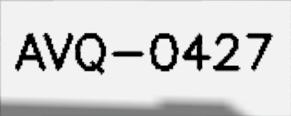
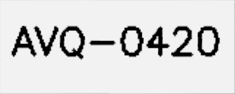

# CPU OCR baseline and training pipeline

This guide covers perception and the original fixed-sequence inspection baseline. The core adaptive action-selection controller is documented in [ACTIVE_VISION.md](ACTIVE_VISION.md).

ActiveVisionQA now has a trained character recognizer integrated with simulated robot inspection. The first model uses **HOG features and a multi-class RBF SVM**, trained locally with OpenCV. It is a classical supervised model, not a neural network. OpenCV documents the underlying [HOG/SVM OCR approach](https://docs.opencv.org/4.x/dd/d3b/tutorial_py_svm_opencv.html).

Scope: one registered text line in the format **three uppercase letters, a hyphen and four digits**, such as `AVQ-0427`. The renderer and training bootstrap use the same built-in font family. Industrial engraving, unknown fonts, general text detection and calibrated reliability remain unvalidated.

## Run the saved robot demonstration

The model produced during implementation is in `outputs/ocr-model-final-01/`.

```bash
bash scripts/run_text_demo.sh --ocr-model outputs/ocr-model-final-01
```

This single command starts an owned Gazebo GUI workcell, runs the fixed-view and active-view text inspections, saves reports, and stops the workcell. The fixed view is blocked and escalates. The active policy requests another viewpoint, reads the expected text and accepts when its gates pass. Expected outcomes are checked against actual evidence; failures are retained.

Open `occluded_active/report.html` inside the printed validation directory. It shows the raw camera observations, rectified text crops, recognized strings and decisions. The GUI is an external scene view; use its scene camera controls to move closer if needed.

For separate terminals:

```bash
# A: load the text workcell
bash scripts/run_simulation.sh config:="$PWD/config/text_inspection.json" scenario:=occluded
# B: start one inspection
bash scripts/inspect_robot.sh --config config/text_inspection.json --scenario occluded \
  --ocr-model outputs/ocr-model-final-01
```

Use the same config/scenario in both terminals. Add `--max-views 1` to limit inspection to the first view. Marker inspection remains the default for the original ArUco config.

## Reproduce generation, training and evaluation

These commands use new output names and the installed system Python/OpenCV. No package installation, external dataset or pretrained weights are required.

```bash
bash scripts/ocr.sh generate --seed 733 --counts 80 20 20 --output outputs/my-ocr-data
bash scripts/ocr.sh train --dataset outputs/my-ocr-data --output outputs/my-ocr-model
bash scripts/ocr.sh evaluate --dataset outputs/my-ocr-data --model outputs/my-ocr-model \
  --split validation --output outputs/my-ocr-validation
bash scripts/ocr.sh evaluate --dataset outputs/my-ocr-data --model outputs/my-ocr-model \
  --split test --validation-report outputs/my-ocr-validation/report.json --output outputs/my-ocr-test
```

The dataset has 80 training, 20 validation and 20 test part identities. Each has clear, blurred, blocked and wrong-ID conditions: 320/80/80 images, 480 total. Associated base/wrong strings and all condition variants stay in the same split. Classes A–Z, 0–9 and hyphen are shared because this is character recognition; whole-word identities are separated.

Training uses 80 generated glyph variants per class (2,960 bootstrap characters), plus aligned characters from the **training split's clear/wrong-ID word images only**. Segmentation failures are excluded with logged reasons rather than forced into label alignment. The final run accepted all 160 eligible word images: 1,280 additional characters, **4,240 total fitting examples**. No validation/test word-image features were fitted.

The final model used fixed C=10 and gamma=3, seed 991, 324-dimensional unit-normalized HOG features and feature/preprocessing version `avqa_hog32_v2`. Training took **2.197 s on CPU**, with 1,225 support vectors. The training-set resubstitution score is stored for diagnostics, not treated as generalization accuracy.

## What is learned and what is configured

The SVM learns character classes from labeled HOG descriptors. Segmentation, known-fixture ROI projection, the identifier format and rejection gates are engineering rules. Expected IDs are compared **after** recognition. Neither expected strings nor the scene's true surface string are supplied to `recognize(image)` or used to fill missing characters.

The pipeline normalizes illumination, segments connected components, conservatively separates touching glyphs at narrow vertical valleys, normalizes each glyph and extracts HOG. It abstains on low contrast, inconsistent segmentation, excessive reference-feature distance or an invalid ID format. Reference distances and class-distance gaps are **not calibrated probabilities**. A reference-template reader provides a non-fitted comparison baseline.

Model bundles contain `svm.yml`, `references.npy` and `model.json`. Metadata records the alphabet, gates, training inputs, seeds, OpenCV version, source hashes and artifact hashes. Loading checks feature-version compatibility and artifact integrity. Existing datasets, models and reports are never overwritten.

Test evaluation requires a preceding validation report matching the frozen model, manifest and annotation hashes. Changing a model or annotations invalidates that linkage. Development datasets used while implementing segmentation are retained separately; the final fresh dataset uses seed 733. The test set was not used to choose model parameters or gates.

## Camera-data adaptation

The twelve earlier camera samples still have blank human readability labels. They were **not used to train the saved model**. After reviewing the gallery and completing annotations, a new model can include reviewed readable training images:

```bash
bash scripts/ocr.sh train --dataset outputs/text-dataset-validation-01 \
  --annotations outputs/text-dataset-validation-01/readability_review.csv \
  --output outputs/my-reviewed-camera-model
```

Only `train` rows annotated `readable` contribute camera features. Unreviewed, unreadable and uncertain camera rows are excluded; a dataset with no eligible training rows fails explicitly. Immutable sample identities, splits and surface strings are checked against the annotation CSV. Synthetic bootstrap glyphs still provide character-class coverage.

Formal camera evaluation requires readability review. For a clearly labeled development check of the old smoke set:

```bash
bash scripts/ocr.sh evaluate --dataset outputs/text-dataset-validation-01 \
  --model outputs/ocr-model-final-01 --split all --development-smoke --output outputs/my-camera-smoke
```

This is an implementation diagnostic across the old split allocations, not a fresh held-out camera benchmark.

## Recorded verification — 13 November 2026

On the final synthetic test split (20 part identities × four conditions):

| Reader | Exact strings / all images | Abstentions | CER including abstentions | False accepts / wrong-ID cases | False rejects / correct-ID cases |
|---|---:|---:|---:|---:|---:|
| Reference templates | 48/80 | 30/80 | 242/640 = 0.378125 | 0/20 | 2/60 |
| Trained HOG/SVM | 58/80 | 22/80 | 176/640 = 0.275 | 0/20 | 0/60 |

The SVM read 20/20 clear images, 20/20 wrong-ID images and 18/20 blurred images exactly. It abstained on all 20 blocked images and two blurred images. The 58 definitive transcriptions happened to be exact in this small same-font set; this does not establish a factory error rate. Unresolved predictions count as full-string deletions in the all-image character error rate rather than disappearing from the denominator.

Validation recorded 59 exact strings and 21 abstentions among 80 images. The old camera development check recorded nine exact strings and three abstentions among twelve images; all three blocked observations abstained. Camera readability remains formally unreviewed, and the set has no wrong-ID camera examples, so its false-accept denominator is zero.

Real Gazebo/MoveIt text validation: **5/5 cases passed**, exit 0, using isolated domain 71:

| Scenario/policy | Actual result | Views | Inspection time |
|---|---|---:|---:|
| Occluded / fixed view | ESCALATE | 1 | 4.306 s |
| Occluded / active | ACCEPT (`AVQ-0427`) | 2 | 7.562 s |
| Wrong ID / active | REJECT (`AVQ-0420`) | 1 | 4.365 s |
| Both views blocked | ESCALATE | 2 | 11.286 s |
| Unreachable goal | ESCALATE, no executed motion | 0 | 1.017 s |

Times exclude simulator startup/readiness. The one-command GUI demo passed both fixed and active cases, and all five original ArUco regression cases passed in a separate domain. All owned workcells were stopped. Logs and HTML reports are retained in `outputs/ocr-robot-validation-01/`, `outputs/ocr-gui-demo-validation-01/` and `outputs/marker-regression-after-ocr-01/`.

`bash scripts/test.sh` completed with **105 tests passed**. Unit/interface coverage includes known OCR inputs, blank/invalid image abstention, expected-ID independence, model integrity, training-split isolation, unreviewed-camera exclusion, annotation integrity, metric denominators and validation/test freeze rules. The colcon package build, Python compilation and shell syntax checks also passed.

Portable results and real camera examples are in [ocr/results.json](ocr/results.json):





This baseline remains limited to a known fixture, the supplied distortion-free camera, one text line, one synthetic font family and a fixed identifier format. Broader fonts, engraving, real images, calibration and larger held-out studies remain future work. The subsequent [adaptive controller](ACTIVE_VISION.md) replaces the fixed viewpoint order with model-based selection. The inherited WSL rendering/physics-mesh and occasional ROS shutdown warnings remain documented; no hardware or safety-certification claim is made.
