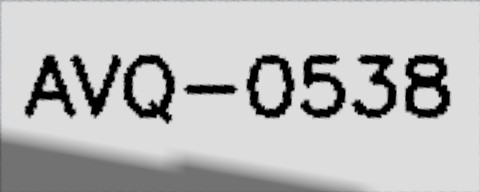

# Synthetic alphanumeric marking dataset

This data phase adds text-bearing parts and robot-camera collection. A subsequent [OCR extension](OCR.md) now provides a trained CPU recognizer and text-inspection integration. The existing ArUco demo remains available.

Text is rendered as native Gazebo visual geometry using OpenCV's built-in `FONT_HERSHEY_SIMPLEX`. This avoids the texture-rendering issue observed during the marker prototype. These are synthetic printed-label-like markings; no physical laser engraving, material defects or industrial glare model is claimed. The drawing API is documented by [OpenCV](https://docs.opencv.org/4.x/d6/d6e/group__imgproc__draw.html).

## Plan before capturing

```bash
bash scripts/build.sh
bash scripts/text_dataset.sh plan --seed 123 --parts-per-split 1 \
  --scenarios clear occluded --output outputs/my-text-plan.json
bash scripts/text_dataset.sh collect --plan outputs/my-text-plan.json \
  --output outputs/my-text-dataset
bash scripts/text_dataset.sh audit outputs/my-text-dataset
```

Use new output names when rerunning; existing plans and datasets are never overwritten. The collector launches and stops its own workcells. It uses ROS domain 69 and a private Gazebo partition, separate from the interactive marker demo on domain 67. Set `AVQA_DATASET_ROS_DOMAIN_ID` to change the collection domain.

The example has one part identity in each split, two scene conditions and two views per scene: **six scenes and twelve camera samples**. It is a pipeline smoke dataset, far too small to estimate OCR performance or train a reliable industrial model.

For a visible single-scene preview:

```bash
bash scripts/text_dataset.sh collect --plan outputs/my-text-plan.json \
  --output outputs/my-text-preview --limit 1 --gui
```

This automatically starts a Gazebo window, moves the simulated arm through its configured views, saves evidence, and closes the owned workcell. The limited preview explicitly reports that the full plan was not captured. The default collection mode is server-only, so it does not open a new GUI window. Full output is retained in `logs/`, with case progress printed in the terminal.

## What varies

The plan chooses unique `AVQ-####` identifiers and predeclares modest part/camera translation, marking yaw and lighting variation. All views and scene variants of a part remain in the same split. Expected and wrong surface strings are also kept disjoint across splits. The same renderer, font and workcell family are shared; this is not a cross-font or real-world generalization test.

Supported scenes: `clear`, `occluded`, `wrong_id`, `all_occluded`. The default smoke plan uses the first two. A wrong-ID scene contains a known different surface string; it does not automatically produce an OCR rejection because no OCR decision is being run.

The numerical seed determines scene inputs and split allocation. MoveIt/OMPL planning and simulator scheduling remain nondeterministic; identical pixel/trajectory replay is not guaranteed.

## Saved evidence

| Artifact | Contents |
|---|---|
| `plan.json` | Predeclared cases, identifiers, split assignments, seeds and configurations |
| `samples.jsonl` | Raw/crop image paths and hashes, ground-truth strings, camera calibration, measured poses, timestamps and motion checks |
| `captures/<case>/events.jsonl` | Full trajectories, motion results and capture events |
| `captures/<case>/capture_result.json` | Collection status and explicit failures; no inspection decision |
| `gallery.html` | Actual camera images and rectified crops for review |
| `readability_review.csv` | Blank manual readability annotations |
| `audit.json` | Integrity, grouping and full-plan completeness checks |
| `collection.json` | Selected cases, subprocess outcomes and collection completeness |
| `configs/`, `worlds/`, `logs/` | Scene snapshots and diagnostic evidence |

Each crop is projected from the **known part fixture geometry**, CameraInfo intrinsics and measured optical-camera pose. It is not a learned text detector. Rectification preserves physical occlusion: a blocked view produces a blocked crop. The current crop implementation requires the shipped distortion-free camera and a fully in-frame label plane.

The audit rejects cross-split part/text identity leakage, plan/label disagreement, invalid image hashes, stale images, wrong frames, missing motion evidence and incomplete full collections. It cross-checks manifest rows against original capture/motion events. This is evidence integrity checking, not independent certification of physical fidelity.

## Review before model training

`surface_text` is scene-generation ground truth. `label_matches_expected` states whether the generated surface ID matches the requested ID. Neither field establishes that the image is readable. All capture records retain `readability_label: null`.

Open `gallery.html`, then fill the CSV's `readability` column with `readable`, `unreadable` or `uncertain`, with notes where useful. Keep camera images and `samples.jsonl` unchanged. The [OCR training command](OCR.md) can consume this CSV; only reviewed readable training rows enter camera-data fitting.

Do not train OCR indiscriminately on blocked images just because their hidden surface strings are known. Review usability and define the target/error costs before adapting the OCR baseline to these camera images. Future model reporting needs a larger newly reserved held-out dataset; this smoke set is for implementation verification.

Use image pixels as recognizer inputs; `surface_text` and `expected_text` are labels/metadata, not input features. Fit on the training split, select settings using validation, and reserve the test split for final reporting.

The data-collection phase itself introduces no model weights, CUDA workload, MuJoCo environment or external dataset. The subsequent OCR phase trains local OpenCV SVM weights from separately generated labels; unreviewed camera samples remain excluded from fitting.

## Recorded verification — 13 November 2026

- `bash scripts/test.sh`: **85 passed**. New checks cover text generation, exact bitmap/native-geometry agreement, camera projection, split leakage, provenance corruption, incomplete collections and blank readability annotation export.
- `bash scripts/build.sh`: colcon package build succeeded. Python compilation and shell syntax checks succeeded.
- `bash scripts/text_dataset.sh collect --plan outputs/text-plan-development.json --output outputs/text-dataset-validation-01`: exit 0, **six scenes / twelve actual robot-camera samples**, four per split. Three distinct part identities; each identity's clear/occluded scenarios and both views stay together. All planned views captured and strict audit passed.
- `bash scripts/text_dataset.sh collect --plan outputs/text-plan-development.json --output outputs/text-dataset-gui-preview-01 --limit 1 --gui`: exit 0, two captured views. The owned GUI launched and closed; the limited preview correctly reports full-plan incompleteness.
- `AVQA_ROS_DOMAIN_ID=70 bash scripts/validate_simulation.sh --include-unreachable --output outputs/marker-regression-after-text-01`: **5/5 original marker cases passed**, exit 0.

The first collection attempt retained ten samples and stopped on the sixth scene with `execution_error_-4`: MoveIt was available before the trajectory controller's action server was connected. Explicit trajectory-controller readiness was added to the shared ROS adapter. The subsequent complete six-scene collection passed; the failed attempt remains in `outputs/text-dataset-smoke-01/`.

Example actual camera crops from the same occluded scene:




The [portable result record](text_dataset/results.json) includes audit and regression summaries. Full evidence and `gallery.html` are in `outputs/text-dataset-validation-01/`. The public examples show the training-part images only. All twelve capture records remain formally unreviewed for readability; no OCR accuracy or trained-model result is claimed.
