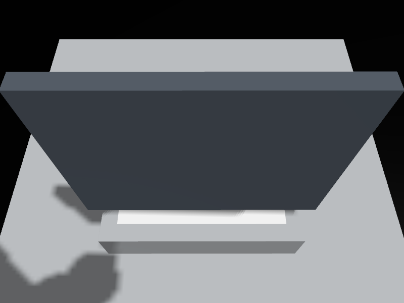
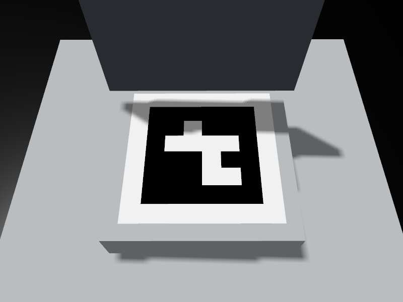

# Recorded validation — 12 November 2026

**13 November update:** The text-data extension passes an expanded **85-test** suite, captures twelve robot-camera samples across six scenes, and reruns all five original marker scenarios successfully. See [TEXT_DATASET.md](TEXT_DATASET.md) for the new evidence. The original results below retain their original date and scope.

**Subsequent 13 November update:** The trained OCR extension passes **105 tests**, five text simulator cases, five marker regressions and the fixed/active GUI demo. Model fitting and the fresh synthetic validation/test results are recorded in [OCR.md](OCR.md).

**Physical AI update, 13 November:** The model-based next-best-view extension passes **125 tests**, **9/9** constructed policy/geometry comparisons from matching initial robot states, **5/5** original text-sequence regressions and an adaptive GUI case. See [ACTIVE_VISION.md](ACTIVE_VISION.md) for overhead/side selection, measured planning/execution evidence and early escalation under full coverage. The dated two-view marker baseline below remains historical evidence.

This is a simulation prototype with an encoded-marker inspection baseline. The results below were executed locally on Ubuntu 24.04 under WSL 2 using ROS 2 Jazzy, Gazebo Harmonic, MoveIt 2 and a simulated UR5e. They are smoke tests of the implemented workflow, not held-out industrial inspection performance.

## Actual Gazebo/MoveIt execution

Command executed:

```bash
bash scripts/validate_simulation.sh --include-unreachable --output outputs/simulation-validation-ik
```

**Result: 5/5 cases passed; validator exit 0.** Each expected outcome also passed the subsequent artifact audit for process exit, event ordering, motion verification, recorded joint/collision checks, image existence, optical frame and image timestamp after motion.

| Generated scenario / policy | Actual outcome | Images assessed | Verified motions | Collision-state samples | Inspection time (s) |
|---|---|---:|---:|---:|---:|
| First view occluded / fixed view | ESCALATE | 1 | 1 | 33 | 4.520 |
| Same scene / active two-view budget | ACCEPT | 2 | 2 | 52 | 7.585 |
| Visible wrong identifier / active | REJECT | 1 | 1 | 33 | 4.355 |
| Both views occluded / active | ESCALATE | 2 | 2 | 84 | 11.355 |
| Unreachable camera goal | ESCALATE | 0 | 0 | 0 | 1.035 |

The unreachable case records one failed planning attempt (`collision_aware_ik_error_-31`) and no execution/image assessment. The active occlusion case records `REINSPECT` followed by `ACCEPT` with detected ID 7. Across the successful motions in this suite, the largest recorded camera position error was 0.000679 m, within the configured 0.025 m tolerance. Angular errors were also checked against 0.12 rad. State-validity sampling is additional engineering validation, not continuous collision certification.

An earlier suite passed 5/5, but a repeat exposed an intermittent second-view planning failure (4/5, retained in `outputs/simulation-validation-final/`). The first repair, IK seeded from the current state, still failed on a repeated inspection. Final code instead uses an explicit configured IK seed and selects equivalent revolutions near it, then plans to the solved joint goal from the actual state. The table above is from the subsequent successful run of that corrected code; failed runs were retained rather than replaced with fixture outcomes.

Times cover the inspection runner: planning, checking, execution, settling, image acquisition and assessment. They exclude simulator startup and ROS adapter readiness. The fixed and active policies ran sequentially in the same scene; their starting arm configurations differ. These single runs do not establish a statistical cycle-time comparison.

### Camera evidence from the simulated arm

First viewpoint: the physical occluder prevents decoding, so the policy requests reinspection.



Second viewpoint: the moved eye-in-hand camera sees the expected marker; the inspector accepts it.



The [portable result summary](validation/results.json) retains outcomes and audit counts. Full local artifacts are in `outputs/simulation-validation-ik/`: per-case `result.json`, `run.json`, `events.jsonl`, images, CameraInfo, generated URDF, simulator metadata and HTML reports. Planned joint positions/velocities/times and measured poses are in the event records. Runtime output is intentionally excluded from Git.

### Interactive GUI check

The GUI launch was also executed, then inspected through the normal user commands:

```bash
bash scripts/run_simulation.sh gui:=true scenario:=occluded
bash scripts/inspect_robot.sh --scenario occluded --output outputs/robot-gui-final-01
bash scripts/inspect_robot.sh --scenario occluded --output outputs/robot-gui-final-02
```

Observed results: **both consecutive inspections ACCEPT**, each with two images and two verified motions, exit 0. Inspection times were 10.827 s and 13.229 s. The second run begins at the previous final arm pose, exercising the repeat-run trigger behind the earlier IK failure. Both artifact audits passed. Gazebo's GUI initialized its scene and camera, and its server supplied the rendered images. The owned simulator was stopped after the check. This verifies launch/rendered-camera operation; it is not a human review of GUI appearance or a GPU benchmark.

## Automated checks

```bash
bash scripts/test.sh
bash scripts/build.sh
```

**62 tests passed.** They cover known perception/policy outcomes, strict view budgets, failed execution handling, stale/missing/wrong-frame images, geometry transforms, configuration/workspace rejection, metric denominators, preservation of existing recordings, generated scene/MoveIt geometry agreement, actual installed Jazzy message interfaces, collision-service rejection, malformed/stale trajectories, collision-aware IK requests/failures/branch wrapping, HTML escaping and simulator evidence audits.

The colcon package build succeeded. Python compilation, shell syntax and launch-argument expansion were also checked. Unit/interface tests do not substitute for the separate Gazebo runs above.

## Offline diagnostic comparison

Command executed:

```bash
bash scripts/run_benchmark.sh --output outputs/fixture-comparison-01
```

The predefined suite has 12 constructed scenarios × seeds 101, 102 and 103 × two policies: **72 fixture runs**, 36 per policy. There are 30 acceptable and 6 wrong-identifier cases per policy.

| Fixture policy | ACCEPT | REJECT | ESCALATE | ERROR | Correct definitive decisions / all cases |
|---|---:|---:|---:|---:|---:|
| Fixed view | 3 | 3 | 27 | 3 | 6/36 |
| Active | 15 | 6 | 12 | 3 | 21/36 |

Both policies recorded 0/6 false accepts and 0/30 false rejects **on these constructed fixtures**. Escalations/errors remain in the denominators. These cases were designed to exercise behavior, not to estimate real failure rates or prove research improvement. The backend is explicitly `offline_fixture`; its motion results are test doubles.

## Known limits and outstanding validation

- The part and markings are synthetic. The baseline checks ArUco IDs and simple quality thresholds, without OCR, engraved-text recognition, calibrated uncertainty or real defect validation.
- The policy uses two predefined candidates. It does not optimize information gain, learn a policy or generalize from a held-out scene distribution.
- The workcell is static and its box obstacles are supplied to MoveIt. There is no depth-based unknown-obstacle reconstruction. Gazebo reported UR mesh-collision construction warnings; do not infer validated contact-physics fidelity from successful motion planning. MoveIt uses the installed UR collision model and explicit workcell geometry.
- WSL rendering reported `/dev/dri` permission warnings but produced camera images and initialized the GUI. The actual renderer/GPU acceleration has not been established. CUDA workloads remain deferred.
- Some successful runs emitted rclpy teardown warnings about destroyed handles after writing valid results. Runs and reports remain available; cleanup stderr is not claimed to be warning-free.
- No real robot, real-image evaluation, scientific novelty, production readiness, certification or customer demand has been established. No Git commit, push or publication was performed.

See [DEPENDENCIES.md](DEPENDENCIES.md) for upstream asset terms. Use the [demo walkthrough](DEMO.md) to present the bounded prototype.
